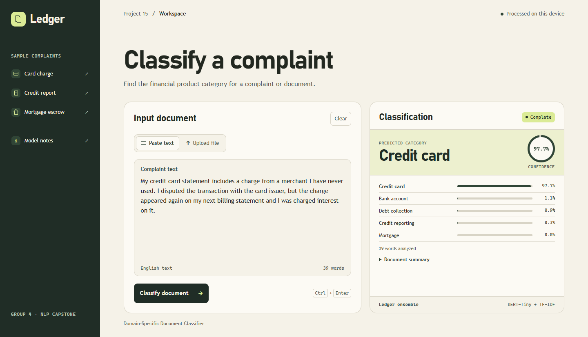

# Ledger

Ledger classifies English consumer finance complaints into Bank account, Credit card, Credit reporting, Debt collection or Mortgage.
The app runs on localhost and combines the included Ledger BERT checkpoint and TF-IDF model.

## Run the app

Follow [START-HERE.txt](START-HERE.txt) for the Python setup and launch commands on Windows, macOS and Linux.
Open [Ledger](http://127.0.0.1:8765) after starting the server.

Use **Card charge** to load a fictional complaint, then select **Classify document**.
For the file demo, switch to **Upload file** and choose a document under `examples/`.
The result shows the predicted category, confidence and all five class scores.
The document summary excerpts the opening sentence and, when available, a sentence related to the predicted category.
The app accepts TXT, text-based PDF and DOCX up to 8 MB and 40,000 extracted characters.



## Reproduce the experiment

```powershell
python collect.py --weights
python train.py --per-class 450 --epochs 12
```

`data/complaints.csv` is the included sample.
Run `python collect.py` to recreate it by streaming the source archive.
The file checksum and archive metadata are in `data/source.json`.
Use `--output path` with `train.py` to generate a new set of artifacts without replacing the shipped checkpoint.
Open `Project_15_Analysis.ipynb` in Jupyter from this directory to work through EDA, evaluation and inference.

| File | Contents |
| --- | --- |
| `plan.md` | Project scope and team roster |
| `collect.py` | Dataset sampling and pretrained weight download |
| `train.py` | Cleaning, splitting, baseline, fine-tuning and evaluation |
| `ledger.py` | WordPiece tokenization and BERT inference |
| `app.py`, `web/` | Local HTTP server and browser UI |
| `data/splits.csv` | Cleaned narratives with fixed dataset splits |
| `model/` | Fine-tuned weights, vocabulary and model license |
| `analysis/` | Metrics and per-complaint test predictions |
| `tools/smoke.mjs` | Browser checks for the demo and upload flows |

## Dataset and model

The source is the CFPB narrative extract distributed with Emil Hvitfeldt and Julia Silge's *Supervised Machine Learning for Text Analysis in R*.
Product labels come from the original complaint records.
The app uses complaint text only.
The project balances five classes for evaluation, so its published test scores apply to that balanced sample. [CFPB data](https://www.consumerfinance.gov/data-research/consumer-complaints/) · [Book data appendix](https://smltar.com/appendixdata)

Ledger BERT starts from Google's BERT-Tiny weights.
Training updates the final encoder feed-forward projection, its LayerNorm and a new five-class head.
The experiment compares BERT, TF-IDF multinomial Naive Bayes and a blend of their scores on the same held-out set. [BERT-Tiny model card](https://huggingface.co/google/bert_uncased_L-2_H-128_A-2)

BERT reads the first 126 WordPiece content tokens, and TF-IDF uses all the extracted text.
It works best on English complaints similar to the U.S. dataset and may be wrong on other document types, ambiguous cases or products outside its scope.
PDFs with image-only pages need OCR before upload.

## Group 4

| Name | Roll number |
| --- | --- |
| Drishti Jain | 2401201036 |
| Neha | 2401201037 |
| Yash Lamba | 2401201038 |
| Teesha | 2401201039 |
| Sohail Khan | 2401201040 |
| Parth Behera | 2401201041 |
